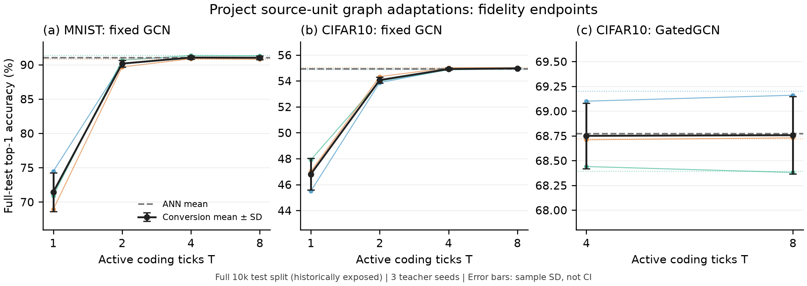

# gnn2snn

GNN→SNN视觉图转换研究的精简归档：关键代码、已验证结果、理论、一个可续写稿件，以及WorkBuddy／Codex研究历史与失败日志。

**状态：2026-11-13按用户要求暂停研究。新方法与当前成稿尚未完成最终验收。**

## 已验证的主要结果

完整官方测试集，三个教师种子（均值±样本SD）：

| 设置 | ANN教师 | 项目源单元图适配T4 | T8 |
|---|---:|---:|---:|
| MNIST · 固定GCN |91.02±0.27%|91.05±0.26%|91.02±0.26%|
| CIFAR10 · 固定GCN |54.94±0.07%|54.92±0.08%|54.97±0.05%|
| CIFAR10 · GatedGCN |68.77±0.41%|68.75±0.33%|68.76±0.39%|

这是完整数据／完整图下的**保真可行性结果**，不是新算法已战胜最强基线、SOTA或节能5×证明。测试集曾被历史开发使用；SD是三个教师seed的描述统计。

## 阅读入口

- [研究总览与证据状态](docs/OVERVIEW.md)
- [WorkBuddy→Codex研究历史](docs/RESEARCH_HISTORY.md)
- [理论与方法](docs/METHODS.md)
- [失败、问题与修复日志](docs/RESEARCH_LOG.md)
- [复现与恢复](docs/REPRODUCE.md)
- [当前进展与待办](docs/STATUS.md)
- [文献核查](docs/REFERENCE_NOTES.md)

## 内容

`research/visual-graphs/`：强教师、转换、校准、独立检查和必要的小型依赖。包含已通过CPU／完整train诊断的affine-base候选，但仍标为探索结果。

`artifacts/verified-evidence.zip`：9个关键教师权重、独立参考预测、完整测试预测和必要校准；有逐文件SHA。`python tools/restore_evidence.py`按原相对路径展开，无需另下大附件。

`results/`与`figures/`：核验过的汇总和图。`paper/historical-draft/`：一份可继续修改的历史稿件，含已知问题，不能直接当成通过新证据验收的终稿。

不上传原始大对话、巨型teacher snapshot、数据缓存和重复失败实验；其经过、结论与教训写入日志。本机原始材料保持不动。整个仓库保留字节校验；不以修改旧哈希来假装复现。
